  <a href="https://tcicsbooking.com">Live project</a> ·
  <a href="https://github.com/Bardmalek/TCICS">Flagship case study</a> ·
  <a href="https://github.com/Bardmalek/carwatch">Computer-vision project</a> ·
  <a href="https://github.com/Bardmalek?tab=repositories">All repositories</a>

I study Computing Science at **Simon Fraser University** and build software around real workflows: event booking, operational dashboards, connected hardware, and computer-vision and decision-support prototypes. I’m especially interested in backend systems, machine-learning systems, and quantitative finance.

### Selected work

| Project | What it shows |
| :--- | :--- |
| **[Tiregan 2026 / TCICS](https://github.com/Bardmalek/TCICS)** | A **deployed** vendor booking platform: interactive floor plan, server-verified PayPal payments, TypeScript Edge Functions on PostgreSQL, and organizer operations. [Visit the site ↗](https://tcicsbooking.com) |
| **[CarWatch](https://github.com/Bardmalek/carwatch)** | Real-time vehicle tracking and driving-pattern analysis: YOLO26 + BoT-SORT, camera-motion stabilization, speed and acceleration with error bars, a behaviour model evaluated on real tracks, and a live local dashboard. 39 tests, CI, and published results, including the ones that didn’t work. |
| **[X-Plane Emergency Assistant](https://github.com/Bardmalek/xplane-emergency-assistant)** | Typed telemetry, a rule-based emergency decision engine behind a swappable interface, and a simulator that runs without X-Plane. 18 unit tests, CI on Python 3.10 and 3.12. |
| **[Sensory Substitution Kit](https://github.com/Bardmalek/sensory-substitution-kit)** | An ESP32 sound-to-touch firmware prototype (FFT, four frequency bands, vibration motors) with a React Native companion app. |

### Featured: Tiregan 2026 / TCICS

**Tiregan 2026** was the festival vendor-booking platform I built and operated for the Tri-City Iranian Cultural Society at **Lafarge Lake Park, Coquitlam**. The festival drew **30,000+ attendees**; vendor booth reservations and online payments ran through this system.

- **The real venue, bookable.** An interactive floor plan with 89 public booth spaces, so vendors pick the actual location, with live availability and checkout holds.
- **Payments the server verifies.** Prices come from a server-side catalog, PayPal orders are captured and checked for amount and currency, and webhook signatures are verified before any booking changes state.
- **Built for the organizer too.** A dashboard with search, CSV export, receipt retries and email alerts, backed by database audit trails.
- **Stack.** TypeScript Edge Functions (Deno) on Supabase PostgreSQL with Realtime, PayPal and Mailgun.

[Read the case study →](https://github.com/Bardmalek/TCICS) · [Event site ↗](https://tcicsbooking.com)

### Things I work with

  
  
  
  
  
  
  
  
  
  
  

Built in Vancouver · Always iterating

